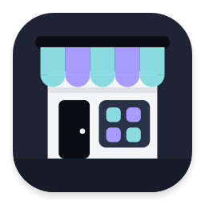

<h1 align="center">

<br/>
Nodalix Store
</h1>

The app store of Nodalix OS. It browses and installs Flatpak apps from
[Flathub](https://flathub.org/), shows the updates of the operating system, and works with NXPM, the
Nodalix package manager, for the system's own packages. It uses the
[Nodalia Design Language](https://github.com/danielmigueltejedor/nodalia-design) (NDL), like the other
core apps of Nodalix OS. Its name on screen is *Store*, and *Tienda* in Spanish.

## What it does today

| Area | State |
| --- | --- |
| Discover | Curated picks, the Flathub front page and its categories, apps made for your toolkit, and a page for every app with screenshots, release notes, permissions, age rating and licence. |
| Search | Full-text search over the catalogue, with filters, and a GNOME Shell search provider. |
| Library | What is installed, with its size on disk and the user data apps leave behind. |
| Updates | Flatpak updates, and the updates of imported AppImages and of the system through NXPM. |
| Install and remove | Flatpak installs for the user, one transaction list with progress and errors, and a Flathub account login for apps that need it. |
| Looks | NDL colours, shapes and density in light, dark and high contrast, with the system font (Adwaita Sans). Nodalix-Icons for apps that are not installed yet. |

The architecture, the permission policy and what is not done yet are in [`docs/`](docs/).

## Install

Nodalix OS ships it: the `nodalix-store` package comes with the system and is the default handler for
`appstream:` and `.flatpakref` links. To build the package yourself from a checkout of
[nodalix-os](https://github.com/danielmigueltejedor/nodalix-os):

```sh
cd packaging/nodalix-store
makepkg -si
```

Run it with `NODALIX_NDL=0 nodalix-store` to open it without NDL, which helps when you debug a style.

## Build from source

You need GTK 4.22, libadwaita 1.8, libflatpak, AppStream, libdex, libsoup 3, glycin, WebKitGTK 6,
libsecret, Vala and `blueprint-compiler`; the full list with versions is in
[`CONTRIBUTING.md`](CONTRIBUTING.md).

```sh
meson setup build
ninja -C build
./build/src/nodalix-store
```

How the NDL style sheets are loaded is in [`docs/NDL.md`](docs/NDL.md); how to debug the app is in
[`docs/debugging.md`](docs/debugging.md). NXPM lives in nodalix-os and is documented in
[`docs/NXPM.md`](docs/NXPM.md).

## Layout

| Path | What it is |
| --- | --- |
| `src/` | The application: the window and its pages, the Flatpak and NXPM backends, the search index and the background service. |
| `src/ndl/` | The NDL style sheets, pinned to an exact commit of nodalia-design, and the one sheet that is Nodalix's own. |
| `bge/` | The small library of GTK widgets the app is built on. |
| `data/` | The desktop file, the metainfo, the settings schema, the D-Bus service and the icon. |
| `po/` | Translations. |
| `docs/` | Architecture, status, permission policy, NDL, NXPM and debugging. |

## Licence

GPL-3.0-or-later, see [`COPYING`](COPYING). The NDL style sheets are MIT, see
[`src/ndl/LICENSE`](src/ndl/LICENSE). Where the code comes from is in [`docs/UPSTREAM.md`](docs/UPSTREAM.md).
